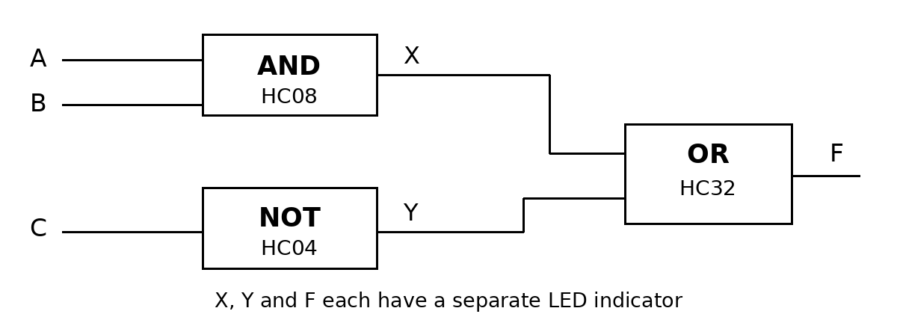
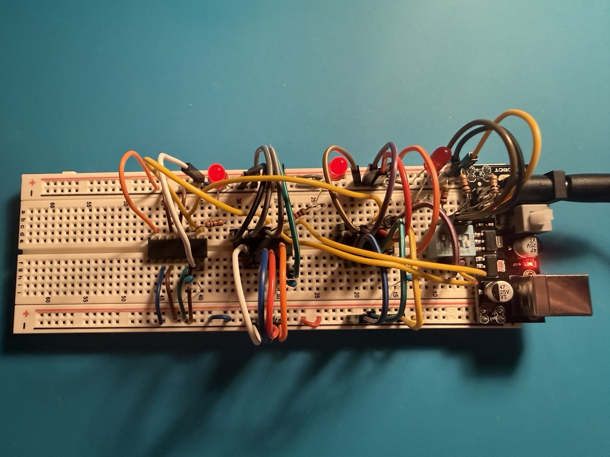
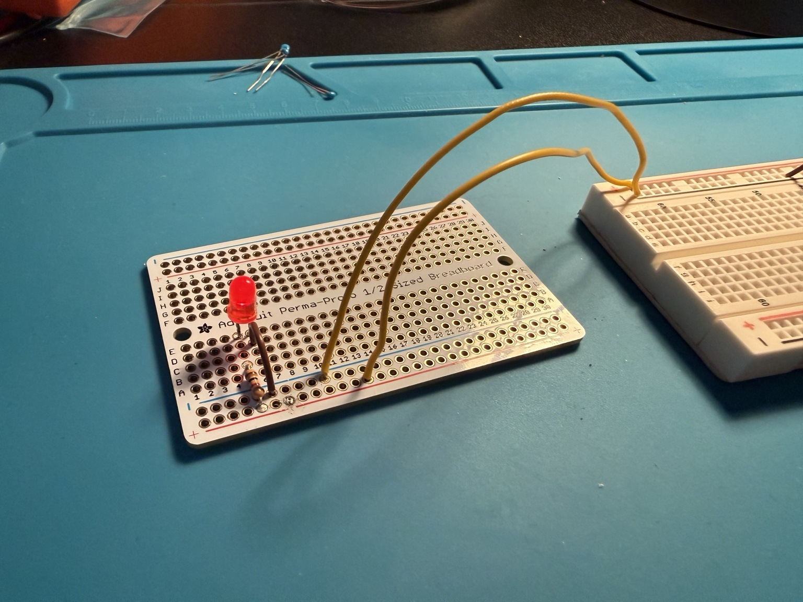

# Digital Logic Mini Project

**Igor Subbotin**

I built a three-input circuit using AND, NOT and OR gates. I tested all eight input combinations with LEDs and a Klein MM420 multimeter. The recorded outputs matched the truth table in all eight tests. I also created an open connection on purpose, found it with the multimeter and fixed it. I soldered a separate LED circuit for practice.

## Parts

Breadboard, jumper wires, SN74HC04N, SN74HC08N, SN74HC32N, CTS 206-4 DIP switch, three LEDs, three 1k resistors, three 10k pull-down resistors and three 100 nF capacitors. I used a DFRobot DFR0140 power module with a 9 V adapter. The soldering circuit uses an Adafruit 1609 Perma-Proto, one more LED and a 1k resistor.

## Circuit diagram

X = A AND B, Y = NOT C, F = X OR Y.

## Files

- [Report](digital_logic_report.pdf): what I built, measured and learned
- [Results](digital_logic_results.csv): eight truth-table tests
- [Electrical schematic](schematics/electrical_schematic.png): pin connections and component values
- [Photos](photos/): circuit tests, the open connection and soldering

## Testing

1. Set inputs A, B and C with the first three DIP switches.
2. Compare LEDs X, Y and F with the truth table.
3. Measure X at HC08 pin 3, Y at HC04 pin 2 and F at HC32 pin 3, relative to GND.

## Results

All eight recorded LED patterns matched the expected outputs. HIGH readings were 4.40-4.56 V and LOW readings were about 0 V. With the LED F branch open, the photo shows 4.73 V at the output while the LED is off. After reconnecting it, the LED lit and the reading was 4.47 V. The separate soldered LED worked with a measured supply of 4.94 V.

## Notes

- Separate HIGH and LOW voltage readings for inputs A, B and C were not logged.
- The report includes the soldering joints and improvements I would make.

## Photos

